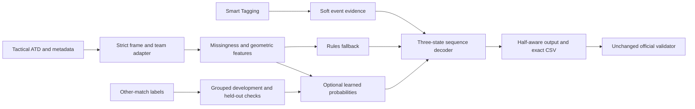
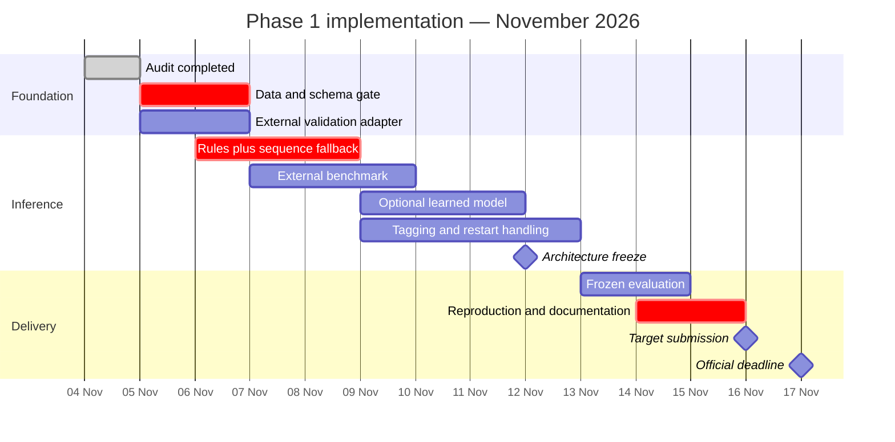

# Ball possession: deep audit and implementation plan

Audit date: 4 November 2026. Planning update: 5 November 2026 — user confirms three contributors and no match-data bundle yet. Planning dates below use India time; the organiser's precise submission cutoff and timezone remain unconfirmed. Target submission: 16 November, one day before the published 17 November deadline.

## Decision

Build a local, offline possession inference pipeline, with a rules-based fallback first and a learned probability model second. Make dead/live inference, missing observations, and possession transitions first-class components. Do not spend this deadline on broadcast alignment, a new tracking stack, a dashboard, or hosted model inference.

The supplied brief identifies the right problem but leaves three delivery risks unresolved: no match assets in the supplied ZIP, no proven external-data label adapter, and no concrete acceptance gates. A sequence model is a hypothesis, not a demonstrated improvement. A valid submission is feasible on a compressed schedule if data arrives promptly; competitiveness cannot be promised.

## Scope and evidence

Reviewed all 15 PDF pages (text and rendered layout); all challenge Markdown documents; all Python modules; the source cells of all three notebooks; the public-label metadata; and the four supplied prediction files. The initial workspace was empty. Extracted 34 files into `reference/more-than-a-hack-2027-main/`; all remain byte-identical to the archive. ZIP identifies source commit `f8f2629ff1e0985f81d7e59d8413678514ee1530`. Checksums are in `source-integrity.json`.

Executed the unmodified scorer, the validator on all four baselines, and synthetic fault probes. Saved the results alongside this report. Did not regenerate the baselines from tracking: the archive contains no tactical/broadcast video, ATD, Smart Tagging, or homography assets. Did not run data-dependent notebook cells, train a model, or measure hidden-match performance. No implementation fixes have been applied to the reference source.

The attachment's instructions were treated as material to assess. This work does not enrol anyone, submit an entry, publish a repository, or contact organisers.

## Where we stand

| Area | Verified state | Consequence |
|---|---|---|
| Working solution | No existing application or inference pipeline in the workspace | Implementation starts from the starter foundation |
| Evaluation | Works locally; all four published public scores reproduced | Reliable baseline for pipeline checks |
| Submission format | All four baseline CSVs pass | Export contract understood |
| Match inputs | Absent from supplied materials | Real ingestion, inference, and regeneration blocked until supplied |
| External training data | Candidate sources verified, not downloaded or decoded | Supervised plan remains conditional |
| Test coverage | No automated test suite or CI configuration in archive | Add focused contract and sequence tests in our implementation |
| Reproducibility | NumPy/pandas are unpinned upstream | Pin our own execution environment and model/config hashes |
| Team capacity | Three contributors confirmed November 5 | Allocate data/reproduction, inference, and validation/release roles |

## Reproduced results

These are measurements on the permitted public pipeline-check window, not model-selection results. The official full-match numbers below are published references, not independently reproduced.

| Baseline | Measured public macroF1 | Measured public spellF1 | Public spellF1 5–95% bootstrap interval | Published full-match spellF1 |
|---|---:|---:|---:|---:|
| raw | 0.5972 | 0.0378 | 0.0189–0.0595 | 0.0486 |
| smooth25 | 0.6200 | 0.2868 | 0.1962–0.3849 | 0.1996 |
| smooth50 | 0.6207 | 0.3256 | 0.2140–0.4465 | 0.2433 |
| smooth125 | 0.5812 | 0.4242 | 0.2667–0.5939 | 0.2242 |

The intervals use the organiser's deterministic 1,000-draw bootstrap. They are not uncertainty bounds on our eventual target score. The reversal between smooth50 and smooth125 is enough to reject choosing a model from public-window ranking.

## Findings: fix or design around these first

Priority P0 blocks meaningful work or validity; P1 risks silently wrong labels; P2 concerns robustness or misleading diagnostics. Synthetic failures below demonstrate input-handling weaknesses, not that the unavailable delivered data contains those defects.

| ID | Priority | Finding and source | Action |
|---|---|---|---|
| A01 | P0 | Match assets absent; `data/` contains only README | Obtain the enrolled participant bundle and check all required files before scheduling real-data milestones |
| A02 | P0 | Public labels are prohibited for training or tuning (`RULES.md`, `EVALUATION.md`) | Isolate target labels from training and search; choose settings using other matches; keep a decision log |
| A03 | P1 | Missing ball becomes `D` in `starter/baseline.py:151`; missing observation and dead play are different states | Retain missingness and gap age explicitly; infer dead/live separately |
| A04 | P1 | `smooth()` at lines 151–175 counts only H/A. D is emitted only when neither appears in the window | Replace this with a three-state decoder. A single H among four missing observations becomes five H labels in the probe |
| A05 | P1 | `starter/load_atd.py:103` checks first/last/count, not every ID | Assert each ID equals the next expected ID. Synthetic IDs 1,2,2,4 incorrectly return `agrees=True` |
| A06 | P1 | Raw baseline parser does not reject IDs outside 1…N, duplicate IDs, malformed rows or nonfinite coordinate pairs (`baseline.py:109–148`) | Fail with a line-specific error or explicit quality policy. Frame 0 writes to the last array element; a NaN y-coordinate in the first player can defeat a valid nearer opponent |
| A07 | P1 | `load_homography.load()` at lines 56–71 checks column presence but does not validate/reindex frame IDs | Validate rows, order, uniqueness, finite valid matrices, and flag values before returning. Reversed IDs load silently in the probe |
| A08 | P1 | Metadata maps every non-home team ID to away (`baseline.py:96–100`) and assumes XML slot ordering | Assert both team identities, every slot's team membership, and raw slot count; reject unknown teams |
| A09 | P1 | Smart Tagging Team names the team performing the event, not always the possessor (`OVERVIEW.md`) | Offensive tags support that team; defensive tags weakly support its opponent; unknown tags are neutral; overlapping correlated tags must not be counted as independent certainty |
| A10 | P1 | Set-piece intervals surround a restart; their start is not the actual live-ball boundary (`01_smart_tagging.ipynb`) | Use intervals as soft timing evidence; refine with motion/context. Never label the entire set-piece window D |
| A11 | P1 | Baseline smoothing is symmetric over 2w+1 frames, without separate-half handling | smooth50 means 101 frames / 4.04 s; smooth125 means 251 / 10.04 s. Process each graded half independently |
| A12 | P1 | External labels and clean tracking can differ from Metrica ownership and automatic tracking | Audit label semantics before training; simulate structured gaps and duplicate/switching tracks; evaluate per match, not random frames |
| A13 | P2 | Submission prose says exact columns; `possession_metrics.py:84–126` accepts extra columns | Keep organiser evaluator untouched; make our exporter stricter and emit exactly frame,label |
| A14 | P2 | `games.py` introductory text describes corrected-tracking offsets as though they apply to input tracking | Use delivered ATD frame_id−1, Smart Tagging round(seconds×25), homography frame unchanged. Do not apply the large per-half offsets to ATD |
| A15 | P2 | Diagnostic possession counts in validator treat X as gaps; scorer fills X within graded runs | Label these diagnostics clearly and compare like-for-like scopes |
| A16 | P2 | Requirements are unpinned; no automated coverage for the above contracts | Freeze versions and add targeted tests in our pipeline; retain upstream scorer as a versioned dependency |

Other useful details: the Smart Tagging helper describes half-open intervals but its kickoff containment check includes the end frame. Standardise on [start, end) in our adapter. Homography's `valid` flag is not an accuracy guarantee; use reprojection error too. Nearest-player ties and smoothing ties favour home in the starter: choose deterministic, documented handling in our implementation and test team-swap symmetry.

## Corrections and qualifications to the PDF

1. **Scoring existing baselines does not regenerate them.** PDF page 15 says reproducing baselines needs only the repo. Their *scores* need only the repo; recreating the CSVs needs ATD. We have completed only the former.
2. **Constant guesses do not mathematically always have zero spellF1.** Page 6 repeats an overbroad upstream statement. A constant H prediction against a synthetic 8-frame H / 2-frame A truth scores 0.6667 because its H interval passes all five overlap thresholds. Zero is an observed property of the published examples, not a universal invariant. Similarly, macroF1 does not have a universal floor near 0.16: all-X can score zero.
3. **Timing and noise numbers are examples, not guarantees.** A one-frame shift can hurt sufficiently short intervals; the quoted 0.04 noise band was measured on a particular full-match setting. Do not apply it to seven different matches or use it as an automatic acceptance threshold.
4. **The all-X case is an exception.** If an entire graded run is X, the scorer has nothing to fill and retains X. Partial gaps are forward-filled, with a backfill at the run head. Carry-forward is useful only if the previous state remains right.
5. **Do not impose a long hard minimum possession duration.** The public semantics include short real possessions. Use soft duration/switching costs, allow strong evidence to support short spells, and avoid treating a few seconds of control as an absolute law.
6. **Dropping 41% of ball frames randomly is not sufficient domain simulation.** Use bursts, long occlusions, correlated player losses, and difficult-region scenarios. Missingness is not independent of play. Fit degradation choices only from permissible unlabeled quality summaries or other-match evidence, without using target labels.
7. **Seven-fold leave-one-match-out is development evidence, not an untouched final test if it drives selection.** Reserve whole match(es) before experiments, or use nested grouping if practical. Never split adjacent windows across training and validation. Seven matches do not make a large independent sample.
8. **Treat dead-ball handling as core work, not a late add-on.** Stoppages create possession boundaries. Ball speed alone cannot establish referee state; dead balls can move and live balls can stop.
9. **Direction normalisation needs an explicit contract.** Preserve home/away labels when reflecting coordinates. Prefer symmetric distances and team-relative features; do not assume team direction from club name or slot identity.
10. **Registration and later phases are now verified.** Official registration ends November 10; Phase 1 ends November 17. Top 20 proceed to November 26–January 14 innovation work; top five reach the March 2, 2027 final. These later dates should not expand the Phase 1 deliverable. [Official organiser page](https://landing.mobileworldcapital.com/more-than-a-hack-2027).
11. **The research catalogue contains leads, not installed capabilities.** TCN results and the ball-inference paper are real, but neither proves improvement on this scorer. Jev performance, the unnamed multimodal paper, PFF coverage, and peripheral CV libraries were not sufficiently verified in this audit; none is a dependency in this plan.

## Proposed implementation

**Input and quality layer.** Use one canonical tactical frame array, retain observation masks, and keep normalised coordinates separately from metre coordinates. Validate 199,319 frame IDs, slot/team mapping, half boundaries and tag intervals. Record missingness by half and gap length, count duplicate tracks, and identify implausible coordinate/speed values. Missing data remains missing; no silent interpolation over long gaps. Published outside-half frames may be X. The second-half graded pre-kickoff interval is documented as D; if used, identify this explicitly as published organiser metadata rather than a learned rule.

**Features.** Nearest and second-nearest player distance per team, distance margin, observed ball speed and change, team speed distributions, nearby player density, distance to pitch edges, ball-visible flag, time since last observation, track counts, and tag evidence. Avoid persistent player identity features. Use finite masks on both coordinates. Calculate derivatives only across compatible observed segments; never differentiate across a missing gap or slot reassignment. Normalise using training data only.

**Rules fallback.** Build confidence-weighted H/A evidence with continuity of the last controlled possession, separate dead/live evidence, and explicit restart handling. Loose or contested balls do not automatically switch possession. Do not force D merely because the ball disappears, and do not hold ownership indefinitely without accounting for confidence and restart evidence.

**Sequence decoder.** Start with deterministic three-state Viterbi decoding on H/A/D emissions and transition penalties. Process halves separately; use future context because this is offline inference. Add soft duration modelling only after the simple version is verified. A full semi-Markov search can cost O(T × duration range × states²); use bounded candidates if added. Preserve short, strongly supported possessions. Keep X mainly outside graded halves; use within-half abstention deliberately, recognising the macroF1 cost and forward-fill behaviour.

**Learned option.** A compact tabular probability model is the first candidate; a small TCN is a stretch candidate only after the external-data harness works. Split dead/live and live-team predictions if it makes calibration and error analysis clearer, then combine as P(D), P(live)P(H|live), P(live)P(A|live). Compare rules-only, model-only, and model-plus-decoder on other matches. Runtime, stable output, and calibration matter alongside spellF1.

**Smart Tagging integration.** Use a named mapping table for offensive, defensive, restart and unknown codes. N/A is not away. Cap correlated overlapping evidence. External datasets may not contain these exact automatic tags; keep the tagging adapter modular and test its semantics with synthetic cases. Gains from this target-only feature cannot be honestly measured through prohibited target-label tuning.

**Export and reproduction.** One command must regenerate a team-named CSV with exact header, integer frames 0…199318, 199,319 rows, and H/A/D/X values. Save model/config/input hashes, seed, package lock, runtime and CSV hash. Run the frozen pipeline twice in a clean supported environment and require identical output bytes. Keep data, derived tracking, caches, and prediction files out of the public repository; document their local paths. Include upstream MIT attribution when reusing source.

Suggested modules: `src/possession/{io,quality,features,tagging,rules,emissions,decode,export}.py`, `scripts/{train,evaluate_external,predict}.py`, `configs/`, `tests/`, `docs/technical-report.md`. The reference scorer stays unchanged under its pinned revision.

## Validation that can support decisions

Use IDSSE first, subject to actual loading and semantic checks. Its official repository confirms seven full matches and a CC-BY 4.0 licence requiring attribution to DFL and the publication. Floodlight's documented IDSSE adapter returns possession and ballstatus objects. This supports an integration trial, not an assumption that every frame has an immediately usable H/A/D label. [IDSSE authors](https://github.com/spoho-datascience/idsse-data), [Floodlight adapter source](https://floodlight.readthedocs.io/en/develop/_modules/floodlight/io/datasets.html).

Before training, inspect possession code definitions, dead/live values, missing labels, temporal alignment and provider treatment of loose balls. Set D from a valid dead flag; only map an alive frame to H/A when ownership is supported. Treat unsupported labels as unevaluable instead of filling fabricated ground truth. Ensure ownership/status are targets, not input features. Ground-truth possession-derived events must not accidentally become predictive features unavailable at competition inference.

With seven usable matches, a practical small-budget split is five development matches for grouped cross-validation and two sealed matches for final comparison. Fit feature scaling, calibration, imputation and model selection within development folds. Use fixed corruption seeds and scenarios on each held-out match; report clean and degraded results separately. Average at match level and show per-match results so a long game does not dominate. Report spellF1, macroF1, dead/live performance, boundary latency, missed/spurious spells, and runtime.

Promotion gate: no contract failures; better development spellF1 across multiple held-out development matches and degradation settings, without merely merging spells or destroying dead/live performance. Make one sealed evaluation of the frozen candidate versus fallback. If results are mixed, retain the simpler robust candidate and state uncertainty. Do not recycle the sealed set into another tuning round.

If external labels fail integration, synthetic tests still establish correctness, not competitive quality. Continue with transparent rules and decoder assumptions; do not invent a validation score or tune against the public window. Use the public GT only for alignment, label semantics, exporter/scorer integration, and diagnosis of concrete pipeline bugs.

Key tests: ID gaps/duplicates/order, nonfinite coordinates, unknown team IDs, metre scaling, no interpolation across halves, tag polarity, N/A tags, half-open endpoints, occlusion within a spell, a real short turnover, dead-ball movement, restart boundaries, team-swap symmetry, all-X, and byte-identical CSV regeneration.

## Timeline and ownership

Confirmed: three active contributors. Planning assumption, not yet confirmed: approximately 4–6 focused hours per contributor per day from November 5–16. Roles: A = data/reproduction; B = inference/model; C = validation/release. These are planning roles, not assigned people. Estimates include concurrent work; availability and dataset access can change them.

| Dates | Owner | Deliverable | Dependency / exit gate |
|---|---|---|---|
| Nov 4 | Audit | Source review, scorer reproduction, risk register | Completed in this audit |
| Nov 5 | A + C | Match bundle check, strict schema, frozen scorer, eligibility/cutoff check | Data accessible; frame/team contract passes |
| Nov 5–6 | C | External-data adapter and label audit | At least one full external match usable; split protocol fixed |
| Nov 6–8 | A + B | Features, rules, H/A/D decoder, CSV exporter | Full-match fallback validates; synthetic edge cases pass |
| Nov 7–9 | B + C | Other-match benchmark with structured corruption | Development reports reproducible; no target-label tuning |
| Nov 9–11 | B | Optional learned probabilities and decoder comparison | External labels usable; promote only on development evidence |
| Nov 9–12 | A | Soft Smart Tagging integration; gap and restart handling | Correct tag polarity, N/A handling, deterministic outputs |
| Nov 12 | All | Architecture freeze | Drop unfinished video/broadcast/TCN experiments |
| Nov 13–14 | C + B | Frozen candidate evaluation and robustness review | Sealed external comparison; select candidate or fallback |
| Nov 14–15 | A + C | Clean-run reproduction, final CSV, technical document | Two runs hash-identical; official validation passes |
| Nov 16 | Team lead | Review repository exclusions and submit three deliverables | Form/account accessible; retain receipt and exact hashes |
| Nov 17 | Team lead | Deadline contingency only | No new model work |

Critical dependency: match access → strict ingestion → complete fallback → reproducible final CSV → submission. The learned model is a removable branch. Missing an optional-model date must never delay the valid fallback.

Timeboxes and contingency:

- If external labels are not usable by November 7, remove the supervised/TCN branch. Finish the rules pipeline and retain uncertainty about competitive performance.
- If target assets arrive after November 8, stop optional research and prioritise format-safe inference, dead/live separation, and reproduction. Without the assets, we cannot claim to regenerate any data-driven result.
- For one contributor, budget roughly 45–60 focused hours: ingestion 8–10, fallback and features 14–18, validation 10–14, reproduction/documentation/submission 10–14. Drop TCN, broadcast, ball reconstruction and a user interface; use learned emissions only if the external adapter is already working. This is an estimate, not observed runtime.
- With three contributors, reserve approximately 100–140 person-hours across the core, external validation and one learned candidate. More people should improve verification and documentation rather than multiply model experiments.
- Do not retrain or change thresholds on November 16–17. Revert to the last reproducible candidate if necessary.

## Research triage

| Lead | Audit outcome | Decision |
|---|---|---|
| Borghesi et al. TCN possession | Author repository confirms H/A/D task and reported 86.2% possession / 89.2% dead-live accuracy | Supports a small local sequence-model experiment; frame accuracy is not our ranking metric |
| Vidal-Codina et al. event detection | Primary arXiv record verified | Reference for possession/restart features, not proof of target performance |
| Kim et al. ball trajectory inference | Primary paper confirms permutation-aware player-context architecture and possession intermediate | Defer: reconstructing coordinates is not required to infer team possession |
| IDSSE | Seven matches and licence verified; loader documentation exposes targets | First external adapter trial |
| Metrica sample data | Official repo provides synchronised tracking/events and EPTS sample | Secondary format/semantics check; continuous H/A/D labels require verification |
| SkillCorner | Official organisation confirms ten-match repository | Lower priority; avoid another adapter before core pipeline works |
| PFF, unnamed multimodal paper, Jev, general CV libraries | Insufficient primary verification here; no dependency installed | Do not include on the critical path |

Primary references: [TCN author record](https://iris.polito.it/handle/11583/2976470), [event detection paper](https://arxiv.org/abs/2202.00804), [ball inference paper](https://arxiv.org/abs/2306.08206), [Metrica sample data](https://github.com/metrica-sports/sample-data), [SkillCorner](https://github.com/SkillCorner).

## Open decisions

1. Match bundle is not yet available, confirmed November 5. Prioritise enrolment/data access; do not mark real-data ingestion complete until it arrives.
2. Three contributors confirmed; individual availability and named role assignments remain open. Confirm registration status before the published November 10 close.
3. Exact submission time/timezone and access to the emailed form. Do not infer midnight India or Barcelona time.
4. External label completeness and semantics after actual loading.
5. Supported inference machine and practical runtime/memory budget, measured on the first full run.

No hidden-match score, winning probability, or guaranteed model improvement can be established from the available materials.

## Audit artifacts

- `source-integrity.json`: archive identity and untouched-file check.
- `evaluation/scoreboard.csv` and `evaluation/reports/`: unmodified scorer outputs.
- `validation.txt`: all four baseline validation outputs.
- `probe_starter.py` and `probe-results.json`: reproducible synthetic failure demonstrations.
- `audit-environment.txt`: package versions used for this audit, not the final solution lockfile.
- `brief.txt` and `brief-page-*.png`: PDF extraction and render evidence.

Reproduce the scorer from the workspace with `audit/.venv/bin/python reference/more-than-a-hack-2027-main/evaluation/run_evaluation.py --out audit/evaluation --bootstrap 1000 --no-detail`. Run synthetic probes with `audit/.venv/bin/python audit/probe_starter.py`.

## November 5 allocation update

- Contributor A: establish registration/data-access status, then implement strict input contracts and synthetic loader tests while waiting for the bundle. Real-data validation remains pending.
- Contributor B: implement a deterministic H/A/D sequence decoder and rules interfaces using synthetic sequences; preserve short possessions and test gaps/restarts.
- Contributor C: trial the external-data adapter, verify label semantics, freeze match-level splits, and maintain reproduction documentation.

November 6 checkpoint: loader contracts and decoder tests run without competition assets; external label adapter either works or has a documented blocker. No claim of a full-match fallback until real data has been processed. Retain the November 7 external-data decision gate and November 16 submission target.
