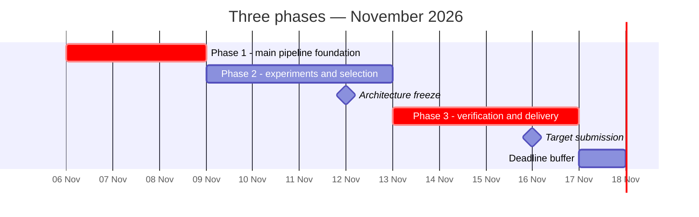

# Ball possession — project plan and running record

Created 2026-11-06, India time. This is the primary human-readable project memory. Read it before work and append important actions after each meaningful step. Detailed prior evidence: [audit](audit/DEEP_AUDIT_AND_IMPLEMENTATION_PLAN.md).

## Objective and current truth

Produce a reproducible algorithmic `frame,label` CSV for 199,319 tactical-video frames, source code and a technical document. Rank objective: spellF1; macroF1 is the first tie-break. Three contributors are confirmed. Publication/submission requires user instruction. Existing reference files are starter material, not our implemented model.

- Inputs: tactical video, tracking, homography, ATD metadata and Smart Tagging now available and locally validated. Optional broadcast has a homography numeric failure and missing team metadata. Real tactical feature arrays materialised; no fitted candidate.

The November 5/6 checkpoints in the earlier plan were planned, not completed. Reset the remaining work from November 6. Target submission November 16; published deadline November 17, exact cutoff/timezone unconfirmed. Registration status must be checked before the published November 10 close.

## Best current approach — a testable candidate

Use a local CPU-first pipeline:

`strict tactical adapter → masked geometric/context features → learned probabilities → soft Smart Tagging evidence → H/A/D Viterbi decoder → deterministic CSV → official validator`

User instruction November 6: do not build a separate fallback. Build the main learned-model pipeline directly; use supplied baselines only as evaluation comparators. Compare direct three-class CatBoost against a two-stage alternative (dead/live, then home/away while live). The previous recommendation of two classifiers was an engineering hypothesis, not established superiority. Missing-value support helps implementation but does not establish that CatBoost beats another model. Neither learned candidate has been trained here.

Make these decisions explicit:

- Model features: per-team nearest distances and margin, ball speed when observed, team movement/density, pitch-edge distance, observation masks and gap age, temporal summaries. No persistent player identity assumptions.
- Missing ball does not imply dead play. Infer stoppages using multiple signals; preserve last controlled ownership through uncertainty where warranted.
- Decoder: deterministic Viterbi with soft switching penalties, separate halves, no long hard minimum spell length. Add duration priors only after evidence supports them.
- Tags: offensive/defensive polarity, unknown/N/A neutral, restart intervals are soft evidence rather than exact restart instants. Do not blindly copy phase tags to possession labels.
- Local execution and pinned environment. Keep competition assets and reconstructive derivatives out of public source and hosted-model calls.
- TCN, broadcast synchronisation, ball reconstruction and a dashboard are deferred. Reopen only if the core is complete and validated before freeze.

## Three phases

### Phase 1 — validate inputs and build the main pipeline foundation (November 6–8)

Goal: prove the data/evaluation contracts and obtain one complete inference path.

1. Contributor A: resolve enrolment/data access; create strict frame, slot/team, coordinate and missingness contracts. Keep private assets outside public source.
2. Contributor B: build features, learned-emission interface, three-state decoder and exact CSV exporter using synthetic sequences while assets are pending.
3. Contributor C: verify IDSSE label semantics and load external matches; fix whole-match development/test splits before modelling; create the experiment harness using the unchanged scorer.
4. Test malformed IDs, partial NaNs, unknown teams, team-swap symmetry, short turnovers, live-ball gaps, moving dead balls, restarts and half boundaries.
5. When assets arrive, validate ATD frame_id−1, tag round(seconds×25), homography frame indexing and full-match output length. Regenerate a reference baseline for the first time; existing audit only rescored supplied CSVs.

Exit gate: synthetic contracts pass; full inference command and exporter exist; real full-match CSV passes the official validator when data is available. If assets remain missing, explicitly record partial completion rather than claiming this gate passed.

### Phase 2 — find which changes improve possessions (November 9–12)

Goal: select a defensible candidate on other matches, using a small set of hypothesis-driven comparisons.

1. Establish supplied raw/smoothed baselines on the same external matches.
2. Test sequence decoding independently of model changes (H1).
3. Train direct H/A/D CatBoost, then compare the dead/live + team factorisation (H2). Use identical features, splits and constrained search budgets.
4. Test burst-gap augmentation and missingness/context features (H3); report clean and corrupted settings separately.
5. Add Smart Tagging adapters and synthetic semantic tests (H4). External data may lack equivalent tags; do not invent measured target gains.
6. Inspect missed/spurious spells, dead/live errors, short-spell recall and boundary shifts. Log refutations as well as successes.
7. Freeze architecture/config/model choices November 12. Drop unfinished optional work.

Exit gate: selected candidate beats or offers a documented robustness advantage over supplied baselines in development evidence; all contracts pass; model/config/input provenance recorded. If evidence is mixed or external labels unusable, retain the best validated main candidate, or report that selection remains blocked. No promised hidden score.

### Phase 3 — verify, reproduce and deliver (November 13–16; November 17 buffer)

Goal: turn the frozen candidate into a verifiable submission.

1. Evaluate frozen candidate and supplied baselines once on sealed external matches; do not reopen tuning based on those results.
2. Run full target inference locally when assets are available; validate the exact final CSV.
3. Reproduce in a clean supported environment, twice, requiring byte-identical CSV hashes.
4. Prepare source, dependency lock, model/config hashes, one regeneration command, licence attribution, and a short technical document with training sources and limitations.
5. Check public-source exclusions and the three deliverables. Team lead reviews and submits November 16; preserve receipt and final hashes. External publication/submission requires an explicit user instruction.

Exit gate: exact CSV validates and reproduces, technical document is complete, repository is reviewable, submission receipt exists after the team submits. November 17 is contingency only.



## Evaluation contract

- Never train, calibrate, choose thresholds/models or tune durations against competition public labels. They support pipeline correctness and label semantics only.
- External labels: verify ballstatus and possession code meanings; exclude unsupported frames; avoid leaking target ownership/status or unavailable event-derived labels into inputs.
- With seven usable external matches: seal two matches; use the other five for grouped development. Record actual match IDs before fitting. Do not pretend these splits are already instantiated.
- Fit preprocessing/calibration inside training folds. Never randomly split neighbouring frames. Compare per-match spellF1 (mean over IoUs 0.3/0.4/0.5/0.6/0.7), macroF1, dead/live quality, boundary latency and runtime.
- Fixed corruption seeds and burst masks; no claiming a random 41% dropout simulates all target noise. Keep synthetic correctness scores separate from external performance and hidden target outcomes.
- Promotion: positive median paired development-match spellF1 change, improvement on a majority of development matches, no median macroF1 drop greater than 0.01, and all correctness tests passing. These are proposed engineering gates, not statistical significance claims. Lock the exact gate in each protocol before running.
- Retain failed/negative experiments and budget/runtime. Reassess after three comparisons or immediately when a core assumption fails.

## Hypothesis queue

| ID | Change and mechanism | Prediction | Comparator | Status |
|---|---|---|---|---|
| H1 | Temporal decoder suppresses unsupported flicker | Higher external spellF1 without eliminating short supported spells | Same emissions, argmax or fixed smoothing | Pending |
| H2 | Separate dead/live and ownership decisions isolate distinct errors | Factorised CatBoost improves spellF1/dead-live tradeoff | Direct three-class CatBoost, matched budget | Pending |
| H3 | Burst augmentation and gap-age/context reflect structured occlusions | Better corrupted-match spellF1 with limited clean-score loss | Same model without augmentation | Pending |
| H4 | Event semantics provide controlled restart/team priors | Correct synthetic polarity/restart handling; field benefit unknown | No tag evidence | Pending |

## Immediate next actions

- [ ] A: establish data access and registration status.
- [ ] C: download and decode one external match, then audit target-label availability.
- [x] B: preregister and implement synthetic decoder contract experiment (J006).
- [ ] A/B: strict loader and exporter tests.
- [ ] C: instantiate match splits and save hashes before learned experiments.

If external labels are unusable by the end of November 8, report the main-model training dependency and investigate compatible external labels; do not silently build a fallback. If competition assets remain absent November 9, report the delivery risk and prioritise the main pipeline input contracts. New research stops November 12; there is no value in an unverified late model.

## Append-only journal rules

Append an entry after every meaningful decision, implementation step, experiment, blocker change or user correction. Never rewrite past results to match a newer interpretation; append a correction referencing the earlier entry. Use India dates/times when known; never invent historical timestamps.

Each entry records: ID/date, provenance (user / AI proposal / executed evidence), phase, action, evidence paths or URLs, result, limitations, decision and next step. Clearly distinguish proposed, running, completed and blocked. Model score claims require a saved result and reproducible command. Log protocol commit before experiment execution; save results in a separate later commit. Keep brief state mirrors in research-state.yaml and findings.md; ball.md remains the main entry point.

## Journal

### J001 — 2026-11-04 — prior audit, executed evidence

Reviewed the supplied PDF and starter archive. Four supplied baseline CSVs validated; public scores reproduced. Evidence: audit/evaluation/scoreboard.csv, audit/validation.txt, audit/source-integrity.json, audit/probe-results.json. Found silent acceptance of duplicate IDs, partial-NaN player errors, unsafe raw ID indexing, and unordered homography loading. These are synthetic demonstrations, not proof the real bundle is corrupt. No baseline regenerated from tracking; no trained model.

### J002 — 2026-11-05 — user constraints

User confirmed three contributors and no separate match bundle. Updated the earlier audit plan. Actual availability/hours and registration status are still unknown.

### J003 — 2026-11-06 — AI proposal, untested

Recommended CatBoost with H/A/D sequence decoding, supported by implementation fit rather than measured superiority. Corrected the earlier implication that two classifiers are established best: compare factorised and direct targets. Main delivery dependency remains real assets. Primary sources retained in literature/survey.md.

### J004 — 2026-11-06 — user request and executed planning

User invoked autoresearch, requested exactly three project phases and an ongoing ball.md record. Created this plan and companion research memory. Configured a 20-minute Codex chat heartbeat under the skill's continuity instruction. It must avoid repeated blocked checks and report meaningful changes only. No external model experiment or implementation result is claimed by this setup. Next: Phase 1 external-data adapter and preregistered synthetic decoder tests.

### J005 — 2026-11-06 — executed setup and preregistration

Initialised local git history (initial plan commit e35f1bf). Wrote the H1 synthetic decoder contract protocol before implementation/execution, including isolated noise, short supported possession, stoppage, half isolation and deterministic symmetry fixtures. Status: not run. Protocol: experiments/h1-decoder-contracts/protocol.md. Created to_human/three-phase-plan.html as a planning report. No improvement trajectory or competitive score exists yet. Next: implement and run this locked contract experiment, or verify external-label loading; record actual results in a later commit.

### J006 — 2026-11-06 — executed evidence, Phase 1

Implemented deterministic H/A/D Viterbi decoding with independent half-open blocks, strict input validation and X outside blocks. Ran the preregistered H1 contract experiment after protocol commit 14385bb: 6/6 confirmatory and 3/3 exploratory tests passed (9 total, 0.228 s unittest runtime). Exploratory tests include an exhaustive small-sequence optimum oracle. Evidence: experiments/h1-decoder-contracts/results/run.json, results/test-output.txt and analysis.md; code: src/possession/decode.py; fixtures: tests/test_decode.py. No training or target data used. H1 external-performance claim remains pending; this is one tested component, not a full inference pipeline. Next: strict adapters/exporter or external label loading.

### J007 — 2026-11-06 — user scope change and input inventory

User removed the separate fallback track, requested Phase 1 work and a last30days search for better available methods, and supplied Archive.zip. Inventory: five nested dataset zips and one tactical video (excluding macOS metadata); nested zips hold tactical/broadcast raw ATD and homographies plus a README. No ATD metadata XML or Smart Tagging XML is present. Do not infer missing teams or read restricted contents into hosted context. Updated current plan; earlier journal entries remain historical. New Phase 1 contract protocol committed before execution.

### J008 — 2026-11-06 — executed Phase 1 foundation

After protocol commit 736dc98, implemented strict adapters, safe nested extraction/provenance, missingness-aware metre-scaled team features, deterministic CSV export and local preparation commands. Final run: 7 new confirmatory methods, 2 new exploratory methods, 9 existing decoder tests, all 18 passed in 0.228 s. Evidence: experiments/phase1-ingestion-contracts/results/run.json and test-output.txt. Real tactical ATD/homography/video-header checks pass; full video decode not tested. Initial validation incorrectly used tactical length for broadcast; corrected to published 164488-frame broadcast timeline and reran only changed broadcast checks. Raw broadcast then passed, but its valid-row homography numeric contract still fails. Keep optional broadcast excluded; do not infer corruption of passing raw data. No scorer modifications, training, predictions or target-label tuning.

### J009 — 2026-11-06 — executed recent-method research and decision

Ran last30days v3.31.0 for October 7-November 6 plus primary paper/code inspection. Most returned social/code matches concerned other tasks; do not treat counts as supporting evidence. PathCRF has pretrained variants but assumes known in-play episodes, rejects incomplete selected-player features, and requires player-trajectory adaptation; pretrained Sportec evaluation risks overlap unless exact split provenance is audited. New October 8 GNN-LSTM paper takes possession/ball-status inputs, so it does not solve our missing-label problem. Decision: retain CatBoost plus decoding as first main candidate, not a proven best model and not a fallback; PathCRF deferred behind an explicit compatibility experiment. Evidence/URLs: literature/recent-methods-2026-11-06.md, last30days-engine-output.txt. No external checkpoint executed.

### J010 — 2026-11-06 — new user input and completed tactical preparation

User supplied BAR-ATH_tactical_smart_tagging.xml; local interval validation passed. A filename-only search located tactical ATD metadata in Downloads/More Than A Hack 2027 - Initial Challenge - Dataset/tactical. Copied both into ignored data/competition with private source hashes. Metadata team/slot checks passed; generated data/competition/derived/tactical_features.npz locally. Shape, no-infinity and half-reset checks passed; no raw/derived rows exposed to hosted context. All required tactical assets are now available. Optional broadcast metadata is still absent. Updated three-phase report and current memory; no separate fallback. Phase 1 remains partial until external-label loading/splits and learned inference are established. Next: external label adapter and split provenance, preregister before model experiments. Automation remains paused as found; not re-enabled.

### J011 — 2026-11-06 — user-requested expanded method search

Executed another last30days run plus primary-paper/code searches. Additional serious leads: TranSPORTmer (ACCV 2024) supports masked trajectory inputs and global state classification; WACV 2026 multimodal CropDrop model reports higher possessor/state accuracy than BallRadar/TranSPORTmer on its own proprietary data. Critical limitation: its evaluation excludes out-of-play sequences, so its state accuracy is not a live/dead result. Public usable checkpoints/code for these two were not verified. BallRadar has public training code and Metrica reproduction path; pretrained availability unverified. No relevant last-30-day result established superiority over the current project candidate. Correct framing: CatBoost is a practical candidate, not the research state of the art. Expanded neural shortlist, no architecture switch or experiment executed. Evidence: literature/expanded-model-review-2026-11-06.md and expanded-model-search-output.txt. Next: verify external labels/splits before comparisons.

### J012 — 2026-11-06 — separately supplied tracking and homography confirmed

User supplied Downloads/BAR-ATH_tactical_atd.txt and Downloads/BAR-ATH_tactical_homography.csv. Local SHA256 comparison confirms both are byte-identical to the archive inputs already validated and used for feature preparation. Private comparison record: data/competition/additional-file-comparison.json. No replacement or redundant schema run needed; no asset contents exposed. Tactical readiness and next action (external labels/splits) unchanged.

### J013 — 2026-11-06 — user-directed core implementation and preregistration

User fixed the architecture to strict adapters, masked core features, CatBoost, Viterbi and deterministic CSV. No optional change before error evidence; same splits/seeds/budget; promotion gate mandatory; stop after three consecutive rejections. Protocol commit 6b71d10 fixes five leave-one-match-out development folds (J03WMX, J03WN1, J03WOH, J03WOY, J03WPY); sealed J03WQQ/J03WR9 will not be downloaded or opened. Development acquisition running. Implemented core/DFL adapter, training and export commands; 21 synthetic tests passed after correcting floating-point comparison at the exact -0.01 gate boundary with 1e-12 tolerance. No measured model score yet. Capsule advisor failed twice; ordinary local tools used. Next: complete acquisition, validate external adapter and run baseline.
| Match | Condition | spellF1 | macroF1 | Missed@.5 | Spurious@.5 | Short recall@.5 | Dead/live errors |
|---|---|---:|---:|---:|---:|---:|---:|
| J03WMX | clean | 0.322746 | 0.875081 | 277 | 741 | 0.28865979381443296 | 181 |
| J03WMX | corrupted | 0.192753 | 0.729203 | 373 | 924 | 0.211340206185567 | 23363 |
| J03WN1 | clean | 0.352838 | 0.854724 | 254 | 628 | 0.36627906976744184 | 294 |
| J03WN1 | corrupted | 0.218022 | 0.719923 | 369 | 734 | 0.2441860465116279 | 19520 |
| J03WOH | clean | 0.298719 | 0.865841 | 211 | 734 | 0.3063063063063063 | 264 |
| J03WOH | corrupted | 0.190335 | 0.736050 | 278 | 819 | 0.25225225225225223 | 19175 |
| J03WOY | clean | 0.272973 | 0.845957 | 263 | 831 | 0.2748091603053435 | 364 |
| J03WOY | corrupted | 0.161771 | 0.715872 | 348 | 927 | 0.22900763358778625 | 20642 |
| J03WPY | clean | 0.340826 | 0.883962 | 211 | 579 | 0.24193548387096775 | 240 |
| J03WPY | corrupted | 0.189080 | 0.754324 | 312 | 752 | 0.18548387096774194 | 20570 |


### J014 — 2026-11-06 — baseline and first promotion

Core baseline completed five leave-one-match-out folds, clean/corrupted. Per-match table above; exact errors/config in experiments/core-development/core. Change 1 (protocol b457d96): switching penalty 2 to 8 passed the gate on all five matches. Median paired spellF1 gain +0.136625; median macroF1 gain +0.024777. Keep penalty 8; no minimum duration. Same trained emissions reused. Table follows. Remaining frequent error: corrupted dead/live classification. Next targeted proposal: one ball-independent mean-player-speed feature, computed only from consecutive observed xy within each half.
| Match | Condition | spellF1 | macroF1 | Missed@.5 | Spurious@.5 | Short recall@.5 | Dead/live errors |
|---|---|---:|---:|---:|---:|---:|---:|
| J03WMX | clean | 0.499781 | 0.902245 | 281 | 173 | 0.14948453608247422 | 127 |
| J03WMX | corrupted | 0.266783 | 0.751594 | 368 | 493 | 0.14948453608247422 | 23320 |
| J03WN1 | clean | 0.496432 | 0.873339 | 267 | 192 | 0.20930232558139536 | 228 |
| J03WN1 | corrupted | 0.281809 | 0.731619 | 362 | 401 | 0.13953488372093023 | 19487 |
| J03WOH | clean | 0.527205 | 0.894625 | 189 | 190 | 0.17117117117117117 | 152 |
| J03WOH | corrupted | 0.296951 | 0.760070 | 264 | 411 | 0.15315315315315314 | 19131 |
| J03WOY | clean | 0.483060 | 0.874689 | 231 | 234 | 0.183206106870229 | 281 |
| J03WOY | corrupted | 0.255513 | 0.738953 | 330 | 470 | 0.16030534351145037 | 20580 |
| J03WPY | clean | 0.536352 | 0.903977 | 199 | 152 | 0.1935483870967742 | 119 |
| J03WPY | corrupted | 0.266804 | 0.772056 | 297 | 428 | 0.13709677419354838 | 20477 |

Gate (tests must separately pass): {"promoted": true, "paired_spell_deltas": {"J03WMX": 0.12553288293933146, "J03WN1": 0.10369072930457524, "J03WOH": 0.16755102997323384, "J03WOY": 0.15191491027949028, "J03WPY": 0.13662494584578377}, "paired_macro_deltas": {"J03WMX": 0.02477731425591223, "J03WN1": 0.015155335353252974, "J03WOH": 0.026401588704415002, "J03WOY": 0.025906507197535178, "J03WPY": 0.018873754075304228}}


### J015 — 2026-11-06 — rejected mean-player-speed feature

Change 2, protocol 967acb0: mean observed player speed failed promotion. Only 2/5 paired match spellF1 improvements, median delta -0.001331; macroF1 median +0.000564. Reject from production, retain experiment code/results for reproducibility. Consecutive rejection count: 1. Per-match table follows. Current best remains core features + penalty8. Error review also shows short-spell recall fell in all clean matches after penalty8 (e.g. J03WMX .289 to .149), supporting one targeted over-merging test.
| Match | Condition | spellF1 | macroF1 | Missed@.5 | Spurious@.5 | Short recall@.5 | Dead/live errors |
|---|---|---:|---:|---:|---:|---:|---:|
| J03WMX | clean | 0.504044 | 0.905028 | 279 | 172 | 0.17010309278350516 | 125 |
| J03WMX | corrupted | 0.259859 | 0.752777 | 374 | 488 | 0.12886597938144329 | 23241 |
| J03WN1 | clean | 0.503784 | 0.872646 | 263 | 188 | 0.19767441860465115 | 248 |
| J03WN1 | corrupted | 0.296799 | 0.741701 | 352 | 383 | 0.13372093023255813 | 18360 |
| J03WOH | clean | 0.529514 | 0.895636 | 187 | 186 | 0.1981981981981982 | 233 |
| J03WOH | corrupted | 0.296109 | 0.759357 | 264 | 411 | 0.15315315315315314 | 18985 |
| J03WOY | clean | 0.479023 | 0.874517 | 236 | 225 | 0.16030534351145037 | 329 |
| J03WOY | corrupted | 0.247328 | 0.740253 | 337 | 473 | 0.11450381679389313 | 20538 |
| J03WPY | clean | 0.518217 | 0.900732 | 217 | 160 | 0.1693548387096774 | 131 |
| J03WPY | corrupted | 0.254735 | 0.770340 | 306 | 425 | 0.11290322580645161 | 20414 |

Gate: {"tests_passed": true, "promoted": false, "paired_spell_deltas": {"J03WMX": -0.001330611393443093, "J03WN1": 0.011170571629686599, "J03WOH": 0.0007340662911897722, "J03WOY": -0.006110932781708545, "J03WPY": -0.01510234462037291}, "paired_macro_deltas": {"J03WMX": 0.0019830228775348235, "J03WN1": 0.004694436125618484, "J03WOH": 0.0001489851308605905, "J03WOY": 0.0005638503486049551, "J03WPY": -0.0024805172517867735}}


### J016 — 2026-11-06 — rejected short-turnover adjustment and stopped additions

Change 3, protocol f765bf3: H/A switching cost4 with D transitions8 failed on all five matches, median paired spellF1 delta -0.054448 and median macroF1 delta -0.008120. Tests passed. Reject; current best remains uniform penalty8. Consecutive rejected changes: 2. Stopping because each supported frequent error category has received its one targeted test; lookahead lacks matching late-boundary evidence. The three-consecutive-rejection ceiling was not reached. Rejected mean-speed code moved out of production into experiment archive; production predictor rejects that feature configuration. Table follows.
| Match | Condition | spellF1 | macroF1 | Missed@.5 | Spurious@.5 | Short recall@.5 | Dead/live errors |
|---|---|---:|---:|---:|---:|---:|---:|
| J03WMX | clean | 0.440181 | 0.894418 | 270 | 353 | 0.21649484536082475 | 127 |
| J03WMX | corrupted | 0.234334 | 0.743181 | 372 | 649 | 0.16494845360824742 | 23320 |
| J03WN1 | clean | 0.456526 | 0.867015 | 242 | 353 | 0.31976744186046513 | 227 |
| J03WN1 | corrupted | 0.260708 | 0.726571 | 358 | 544 | 0.21511627906976744 | 19487 |
| J03WOH | clean | 0.431496 | 0.883597 | 185 | 397 | 0.26126126126126126 | 152 |
| J03WOH | corrupted | 0.259567 | 0.749261 | 261 | 565 | 0.21621621621621623 | 19131 |
| J03WOY | clean | 0.373559 | 0.857557 | 238 | 506 | 0.2748091603053435 | 281 |
| J03WOY | corrupted | 0.210510 | 0.725432 | 335 | 679 | 0.22900763358778625 | 20580 |
| J03WPY | clean | 0.459227 | 0.895341 | 201 | 291 | 0.23387096774193547 | 119 |
| J03WPY | corrupted | 0.235032 | 0.766138 | 305 | 542 | 0.16129032258064516 | 20477 |

Gate: {"tests_passed": true, "promoted": false, "paired_spell_deltas": {"J03WMX": -0.0460244974660356, "J03WN1": -0.030503974472165185, "J03WOH": -0.06654634864347708, "J03WOY": -0.0772522705501913, "J03WPY": -0.05444799795092592}, "paired_macro_deltas": {"J03WMX": -0.008119984056398577, "J03WN1": -0.005686018730243103, "J03WOH": -0.010918228696249366, "J03WOY": -0.015326543095595335, "J03WPY": -0.007277203495620221}}


### J017 — 2026-11-06 — Phase 1 complete, selected candidate generated

Completed strict adapters → nine masked core features → CatBoost H/A/D probabilities → Viterbi (uniform switch cost8) → deterministic CSV. Final model trained on five development matches only. Local target candidate: data/competition/predictions/candidate.csv, 199319 frames; official schema validator passed. Saved-model reload and fresh probability/decoder execution produced byte-identical candidate-repeat.csv. 23 tests passed; all 34 reference files unchanged; sealed match assets absent. Evidence: experiments/core-development/completion.json; private target hashes/validation in predictions/provenance.json and official-validation.txt. Mean development clean spellF1/macroF1 and corrupted metrics are recorded in completion.json; per-match tables above. No target quality score or sealed generalisation claim. Kept only penalty8; rejected mean speed and short-turnover cost4. Earlier broader architectural/feature queues are superseded by the user's core-only, error-driven scope. Phase 1 implementation complete; next is review of this development-selected candidate and future phase work without opening sealed matches unless explicitly authorised.


### J018 — 2026-11-06 — Authorized GitHub delivery
User explicitly requested direct delivery to dhrooovvv/football main, using Git author name dhroovvv. Checked tracked history: competition assets, local models, audit environment and reference starter remain excluded. Publishing implementation and research records only; no competition submission.


### J019 — 2026-11-06 — Status review and ongoing journal maintenance

User reaffirmed that important decisions, actions, evidence, failures and next steps must be appended here. Preserve earlier journal entries; later dated corrections take precedence over stale summaries.

- GitHub delivery completed: origin/main at 9ae2ab7 after implementation commit 6056397; author name configured as dhroovvv. Private assets and model files excluded.
- Phase 1 exit gate passed according to recorded evidence in experiments/core-development/completion.json: 23 tests, official CSV validation, identical saved-model regeneration, 199319 output frames. This status review inspected code and records; it did not rerun tests or inference.
- Selected candidate remains nine core features + CatBoost + uniform Viterbi penalty8. Mean development clean spellF1/macroF1: 0.508566/0.889775; fixed-corruption: 0.273572/0.750858. Penalty8 improved all five paired matches; median paired spellF1 gain 0.136625. Mean-speed and asymmetric short-turnover changes rejected. Two consecutive rejections, not three; additions stopped because supported candidate categories were exhausted.
- Correctness checks establish tested contracts and export validity, not competition accuracy. Corruption robustness remains weak; sealed generalisation and target quality remain unmeasured. No target public-label tuning, sealed evaluation or competition submission occurred.
- Documentation review found stale zero-external-run statements and a null baseline mirror. Older broad feature/model queues are superseded by the user's core-only error-driven scope. Reconcile current summaries without rewriting historical journal entries.
- Next: focused correctness review and clean-environment reproduction (not yet executed); any subsequent experimental change requires a committed protocol and the existing paired promotion gate. Freeze architecture November 12; November 13–16 reserved for frozen evaluation, reproducibility and packaging. Keep sealed matches closed during development. Automation remains paused.


### J020 — 2026-11-06 — Frozen diagnostics, grid audit and pending proposal
Protocol d61a02f committed before execution. Frozen target inference and unchanged public scorer executed once solely for alignment checks; score/details remain private under data/diagnostics-review/public-score.json, excluded from selection. No target rows printed. Frame indexing, explicit named teams, direction invariance, configured metric scaling and X outside configured graded blocks pass contracts. Public score cannot independently prove semantic correctness.
Label-free target gap bootstrap refitted: missing fraction .4069, missing-run median268/p90 845.3/max5537 frames; original25–100-frame gaps were too short. External ball-speed median1.1757 versus target5.0818m/s signals feature shift. Fixed seeds and original player corruption retained; empirical alternating runs do not model conditional missingness. All target run lists and detailed distributions remain private.
Frozen penalty8 mean clean spellF1/macroF1 .508566/.889775; target-like .312864/.672865. Corruption settings changed, so do not directly compare old/new corrupted scores for promotion. Same-match baseline raw/smooth25/50/125 and nearest+decoder completed. Best smoothed baseline50: clean .296145/.384029; target-like .196645/.438793. Full per-match metrics, missed/spurious, short recall, boundary quantiles and oracle repairs in experiments/diagnostics-review/results.json and summary.md.
Penalty8 was upper grid edge;16 and32 evaluated.16 passes gate (3/5 improve, median paired spell +.010056, macro +.006132);32 fails. Production remains8 pending review; no combined change applied.23 tests pass. Execution-order deviation: grid computations ran alongside Step2, before Step3 baselines and final taxonomy; primary four diagnostic steps themselves ran in order. Scorer unchanged; sealed matches untouched.
Clean wrong-team/ownership oracle repair dominates all5; target-like wrong-team dominates3/5, dead/live2/5, with27k–34k dead/live wrong frames. Categories overlap; unique causal spellF1 attribution is not proven. Boundary medians zero describe matched typed boundaries only. One proposal preregistered: seeded half of training feature samples replaced by target-pattern corrupted features, same total samples/features/CatBoost/decoder budget. See proposed-gap-training.md. NOT approved or executed; wait for user approval and confirm parent, avoiding combined grid/augmentation changes.
Documentation append initially failed under system Python missing numpy; no diagnostic failed. Corrected using project environment.


### J021 — 2026-11-06 — Approved augmentation, fidelity, decoder isolation and semantic review
Protocol577294b committed before execution; user explicitly approved augmentation against frozen penalty8 and separate decoder16 promotion. All three prerequisite diagnostics completed before fitting. No public performance rescore, target training, sealed access or competition rows exposed. Full report: experiments/gap-augmentation/report.md; detailed decoder and augmented per-match taxonomy JSON alongside.
Fidelity graded-frame missing fractions: target .406926; target-like matches .357238/.400675/.475163/.423675/.359002; original .268307/.280762/.261846/.262488/.259768. Empirical bootstrap is approximate, not exact rate matching. Raw ball positions are masked BEFORE computing nine features; ten train/evaluation cache audits verify masks, gap age and speed consistency. Evaluation seeds20261106+i; training20271106+i; exact half-row replacement20281106+i. Total sampled rows, model iterations and folds unchanged.
Original corruption mean spurious/missed @IoU.5:440.6/324.2; target-like217.0/336.0. Longer gaps suppress fragmentation while erasing more frames, consistent with spellF1 rising and macroF1 falling; multiple corruption properties changed, so not isolated causal proof.
Decoder comparison uses identical CatBoost probabilities: argmax, supplied centered H/A smoothing50, Viterbi8/16. Smoothing ignores D votes, explicitly documented; nearest-player decoder's .98/.01 emissions were near-hard and not decoder-isolation evidence.
External dead shares41.5–51.7%, mean possession spells5.47–7.74s; public documented/computed aggregate19.59%,14.19s,17 spells. Nominal H/A/D semantics agree but loose-ball ownership continuation and external unknown-as-X fragmentation are not proven equivalent. Baseline macroF1 gap suggests potential convention/domain mismatch, not proof: external clean ball is continuously observed, so missing=>D baseline misses dead play; target missingness is40.7%. No label convention changed or tuned.
Augmentation passes existing paired gate4/5, median spell delta+.003268, macro-.001228; primary corrupted median spell delta+.001957,4/5 improve. Penalty16 separately passes3/5, median spell+.010056, macro+.006132. Selected unaugmented production config promoted to16; augmentation+8 retained as a separate passing branch. NO untested augmentation+16 combination. Existing targetCSV/completion record still describe penalty8; no new export or augmented final full-development model.23 tests plus10 cache audits pass. Reporting failed initially on numpy int64 JSON serialization; fixed and reran report only, no model rerun. Per-match failures/regressions retained below. Stop now per user; no further experiment.

| Match | Setting | Method | spellF1 | macroF1 |
|---|---|---|---:|---:|
| J03WMX | clean | argmax | 0.083883 | 0.852236 |
| J03WMX | clean | smooth50 | 0.342353 | 0.836020 |
| J03WMX | clean | penalty8 | 0.499781 | 0.902245 |
| J03WMX | clean | penalty16 | 0.501360 | 0.907574 |
| J03WMX | targetlike | argmax | 0.074322 | 0.648709 |
| J03WMX | targetlike | smooth50 | 0.208907 | 0.684237 |
| J03WMX | targetlike | penalty8 | 0.304892 | 0.685807 |
| J03WMX | targetlike | penalty16 | 0.323426 | 0.692742 |
| J03WN1 | clean | argmax | 0.089149 | 0.831715 |
| J03WN1 | clean | smooth50 | 0.318708 | 0.805028 |
| J03WN1 | clean | penalty8 | 0.496432 | 0.873339 |
| J03WN1 | clean | penalty16 | 0.484682 | 0.875014 |
| J03WN1 | targetlike | argmax | 0.076368 | 0.647077 |
| J03WN1 | targetlike | smooth50 | 0.230103 | 0.672068 |
| J03WN1 | targetlike | penalty8 | 0.310214 | 0.675876 |
| J03WN1 | targetlike | penalty16 | 0.313253 | 0.680025 |
| J03WOH | clean | argmax | 0.072041 | 0.842809 |
| J03WOH | clean | smooth50 | 0.352104 | 0.827188 |
| J03WOH | clean | penalty8 | 0.527205 | 0.894625 |
| J03WOH | clean | penalty16 | 0.568452 | 0.903698 |
| J03WOH | targetlike | argmax | 0.057446 | 0.604913 |
| J03WOH | targetlike | smooth50 | 0.256101 | 0.641767 |
| J03WOH | targetlike | penalty8 | 0.325326 | 0.637961 |
| J03WOH | targetlike | penalty16 | 0.343671 | 0.646450 |
| J03WOY | clean | argmax | 0.084798 | 0.827114 |
| J03WOY | clean | smooth50 | 0.316787 | 0.798138 |
| J03WOY | clean | penalty8 | 0.483060 | 0.874689 |
| J03WOY | clean | penalty16 | 0.516129 | 0.885072 |
| J03WOY | targetlike | argmax | 0.072080 | 0.623098 |
| J03WOY | targetlike | smooth50 | 0.227797 | 0.654792 |
| J03WOY | targetlike | penalty8 | 0.294293 | 0.654699 |
| J03WOY | targetlike | penalty16 | 0.312291 | 0.663388 |
| J03WPY | clean | argmax | 0.053460 | 0.847426 |
| J03WPY | clean | smooth50 | 0.361435 | 0.840343 |
| J03WPY | clean | penalty8 | 0.536352 | 0.903977 |
| J03WPY | clean | penalty16 | 0.517647 | 0.904135 |
| J03WPY | targetlike | argmax | 0.040472 | 0.668697 |
| J03WPY | targetlike | smooth50 | 0.244268 | 0.711043 |
| J03WPY | targetlike | penalty8 | 0.329596 | 0.709985 |
| J03WPY | targetlike | penalty16 | 0.324741 | 0.714401 |
| J03WMX | clean | augmentation_penalty8 | 0.497380 | 0.901670 |
| J03WMX | targetlike | augmentation_penalty8 | 0.306849 | 0.691008 |
| J03WN1 | clean | augmentation_penalty8 | 0.496104 | 0.870904 |
| J03WN1 | targetlike | augmentation_penalty8 | 0.317900 | 0.683337 |
| J03WOH | clean | augmentation_penalty8 | 0.532497 | 0.896916 |
| J03WOH | targetlike | augmentation_penalty8 | 0.323209 | 0.632202 |
| J03WOY | clean | augmentation_penalty8 | 0.494537 | 0.875849 |
| J03WOY | targetlike | augmentation_penalty8 | 0.302133 | 0.651082 |
| J03WPY | clean | augmentation_penalty8 | 0.542234 | 0.903090 |
| J03WPY | targetlike | augmentation_penalty8 | 0.330251 | 0.702075 |

Gate per-match deltas (negative values record regressions):

```json
{
  "augmentation_penalty8": {
    "promoted": true,
    "paired_spell_deltas": {
      "J03WMX": -0.00022193826318522847,
      "J03WN1": 0.0036787241429445117,
      "J03WOH": 0.001587724148415015,
      "J03WOY": 0.00965871609835689,
      "J03WPY": 0.003268297228421202
    },
    "paired_macro_deltas": {
      "J03WMX": 0.0023127285947391885,
      "J03WN1": 0.0025130177800606335,
      "J03WOH": -0.0017340576715769718,
      "J03WOY": -0.0012284997026200672,
      "J03WPY": -0.004398661314549468
    },
    "median_paired_spell_delta": 0.003268297228421202,
    "median_paired_macro_delta": -0.0012284997026200672,
    "matches_improved": 4,
    "primary_corrupted_spell_deltas": {
      "J03WMX": 0.0019573924291301226,
      "J03WN1": 0.0076859846144252675,
      "J03WOH": -0.0021164459962100257,
      "J03WOY": 0.00784019477507153,
      "J03WPY": 0.000655162852059521
    },
    "primary_median_delta": 0.0019573924291301226
  },
  "penalty16": {
    "promoted": true,
    "paired_spell_deltas": {
      "J03WMX": 0.010056145887024415,
      "J03WN1": -0.004355378129752785,
      "J03WOH": 0.029795910809050974,
      "J03WOY": 0.02553331089575983,
      "J03WPY": -0.011780114797252161
    },
    "paired_macro_deltas": {
      "J03WMX": 0.006132432243620589,
      "J03WN1": 0.002911878637101184,
      "J03WOH": 0.00878120529098314,
      "J03WOY": 0.009536229165395538,
      "J03WPY": 0.002286797387688666
    },
    "median_paired_spell_delta": 0.010056145887024415,
    "median_paired_macro_delta": 0.006132432243620589,
    "matches_improved": 3,
    "primary_corrupted_spell_deltas": {
      "J03WMX": 0.01853377005585105,
      "J03WN1": 0.003039235326102452,
      "J03WOH": 0.018345271025298093,
      "J03WOY": 0.017997698823072783,
      "J03WPY": -0.0048550871601720225
    },
    "primary_median_delta": 0.017997698823072783
  }
}
```


### J022 — 2026-11-06 — Combined augmentation rejected; label-free aggregates; pending whole-pitch bundle
Protocol e1fc684 committed before execution. Reused fixed augmentation fold models, same folds/seeds/budget/masks; only decoded at16 against unaugmented16 parent.23 tests passed. Reject augmentation on current parent; historical augmentation8 result remains archived, not retained as an active branch. No new training or targetCSV export required. No public labels loaded, no sealed assets, no target class tuning. Consecutive rejected changes1.

# Combined augmentation16 decision and label-free diagnostic

**Reject augmentation; keep unaugmented penalty16.** Gate:2/5 matches improve, median paired spellF1 delta-.001331, macroF1-.000708. Primary corrupted median delta+.000119 does not override the unchanged gate.23 tests pass.

| Match | Condition | Parent spellF1 | Combined spellF1 | Parent macroF1 | Combined macroF1 |
|---|---|---:|---:|---:|---:|
| J03WMX | clean | 0.501360 | 0.488557 | 0.907574 | 0.905297 |
| J03WMX | targetlike | 0.323426 | 0.323544 | 0.692742 | 0.697768 |
| J03WN1 | clean | 0.484682 | 0.478500 | 0.875014 | 0.872922 |
| J03WN1 | targetlike | 0.313253 | 0.320537 | 0.680025 | 0.690129 |
| J03WOH | clean | 0.568452 | 0.568915 | 0.903698 | 0.905187 |
| J03WOH | targetlike | 0.343671 | 0.352305 | 0.646450 | 0.643546 |
| J03WOY | clean | 0.516129 | 0.511568 | 0.885072 | 0.883676 |
| J03WOY | targetlike | 0.312291 | 0.310799 | 0.663388 | 0.658861 |
| J03WPY | clean | 0.517647 | 0.517088 | 0.904135 | 0.903661 |
| J03WPY | targetlike | 0.324741 | 0.322639 | 0.714401 | 0.708315 |

## Label-free target output vs external ground truth

Target diagnostic uses frozen unaugmented model with penalty16, configured graded halves only; no public labels loaded. H/A spells are maximal runs, reset at half boundaries. External unknown-label gaps also split spells. Durations/coverage differ, so counts are descriptive, not matched quality comparisons.

| Aggregate | Target prediction | External ground-truth min–max |
|---|---:|---:|
| H share (%) | 36.564 | 25.728–35.012 |
| A share (%) | 21.481 | 20.702–31.691 |
| D share (%) | 41.955 | 41.515–51.698 |
| H/A possession spells | 467.000 | 402.000–511.000 |
| Mean possession duration (s) | 7.898 | 5.470–7.740 |

Target graded frames:158857; all H/A/D segments:625, mean duration:10.167s. These are not possession-spell counts.

No public-window comparison, label scoring, rebalancing or calibration. Target share/duration differences do not establish correctness or error. Existing candidate.csv remains the earlier penalty8 export; this round calculated aggregates only.

## Next experiment — not run

Whole-pitch bundle preregistered in proposed-whole-pitch.md against unaugmented penalty16. Longitudinal centroid separation uses absolute attack-axis projection, giving one nonredundant direction-invariant scalar. New bundle awaits approval. Consecutive failures1; existing stop rule and November12 freeze unchanged. Stop after this report.

Gate per-match deltas:
```json
{
  "promoted": false,
  "paired_spell_deltas": {
    "J03WMX": -0.006341939152425591,
    "J03WN1": 0.0005507299283303846,
    "J03WOH": 0.004548898410885571,
    "J03WOY": -0.00302598633393103,
    "J03WPY": -0.001330725871319216
  },
  "paired_macro_deltas": {
    "J03WMX": 0.0013744000856413807,
    "J03WN1": 0.00400596868665648,
    "J03WOH": -0.0007079634766201659,
    "J03WOY": -0.002961773057585937,
    "J03WPY": -0.0032798135226800307
  },
  "median_spell_delta": -0.001330725871319216,
  "median_macro_delta": -0.0007079634766201659,
  "matches_improved": 2,
  "primary_corrupted_spell_deltas": {
    "J03WMX": 0.00011861110225425131,
    "J03WN1": 0.007283900703485113,
    "J03WOH": 0.008634360346944092,
    "J03WOY": -0.0014910638031137569,
    "J03WPY": -0.0021020600810705004
  },
  "primary_median_delta": 0.00011861110225425131,
  "tests_passed": true
}
```


### J023 — 2026-11-07 — Rolling whole-pitch rejected; final16 exported and reproduced; technical draft
Protocol2a48539 committed before execution with user amendments: fixed trailing2.5s window (63 observations), five ball-independent aggregates, original gate PLUS median corrupted spellF1 gain>=+.01. No grid, budget, split or corruption changes. Both gates failed:1/5 paired improvements, median paired spell-.006600, macro+.000476; corrupted primary median-.005208. Drop whole bundle; rejected source/tests archived under experiments/whole-pitch. Stop all feature additions per user, even though consecutive rejection count is2 rather than3.25 experiment tests passed (including2 feature contracts).

# Rolling whole-pitch experiment — rejected

Parent: unaugmented nine-core CatBoost + penalty16. Five-column bundle used fixed trailing2.5s (63observations) means, independent of ball masks; no parameter/window/grid search. Same folds, seeds, budget and target-like corruption.

**Both gates fail:** existing paired gate fails (1/5 improve, median spellF1 delta-.006600); minimum median corrupted gain fails (-.005208 versus required+.01). Drop bundle and stop feature additions.25 tests passed including2 new feature contracts; rejected implementation/tests archived here for reproduction, excluded from production.

| Match | Condition | Parent spellF1 | Bundle spellF1 | Parent macroF1 | Bundle macroF1 |
|---|---|---:|---:|---:|---:|
| J03WMX | clean | 0.501360 | 0.445217 | 0.907574 | 0.899143 |
| J03WMX | targetlike | 0.323426 | 0.277677 | 0.692742 | 0.683453 |
| J03WN1 | clean | 0.484682 | 0.479126 | 0.875014 | 0.871808 |
| J03WN1 | targetlike | 0.313253 | 0.309434 | 0.680025 | 0.679476 |
| J03WOH | clean | 0.568452 | 0.531751 | 0.903698 | 0.905597 |
| J03WOH | targetlike | 0.343671 | 0.324675 | 0.646450 | 0.653453 |
| J03WOY | clean | 0.516129 | 0.508136 | 0.885072 | 0.885687 |
| J03WOY | targetlike | 0.312291 | 0.307082 | 0.663388 | 0.663725 |
| J03WPY | clean | 0.517647 | 0.507955 | 0.904135 | 0.902576 |
| J03WPY | targetlike | 0.324741 | 0.337463 | 0.714401 | 0.718625 |

## Dead/live quality where ball is missing

Subset: graded frames with ball_observed=0; binary classes dead versus live, H/A collapsed. Clean external matches have no missing-ball frames, so those subset metrics are undefined, not zero.

| Match | Missing frames | Parent binary macroF1 | Bundle binary macroF1 | Parent D precision/recall/F1 | Bundle D precision/recall/F1 | Parent errors | Bundle errors |
|---|---:|---:|---:|---|---|---:|---:|
| J03WMX | 52145 | 0.2680 | 0.2680 | 0.3649/1.0000/0.5347 | 0.3649/1.0000/0.5347 | 33105 | 33105 |
| J03WN1 | 56720 | 0.3452 | 0.3452 | 0.5260/1.0000/0.6893 | 0.5260/1.0000/0.6893 | 26881 | 26881 |
| J03WOH | 65199 | 0.3239 | 0.3242 | 0.4786/1.0000/0.6474 | 0.4787/1.0000/0.6475 | 33989 | 33979 |
| J03WOY | 60389 | 0.3096 | 0.3092 | 0.4465/1.0000/0.6174 | 0.4464/1.0000/0.6173 | 33408 | 33420 |
| J03WPY | 52490 | 0.3216 | 0.3216 | 0.4718/1.0000/0.6412 | 0.4718/1.0000/0.6412 | 27708 | 27708 |

Whole-pitch speed is slot displacement, not verified identity motion; compactness reflects visible slots, and player missingness can bias aggregates. No causal claim about why the bundle failed; no posthoc subsets or new feature attempts. Sealed matches and public labels untouched. Finalization follows the requested order: final target export twice + validator, clean-environment reproduction/hashes, technical document.

Gate details:
```json
{
  "promoted": false,
  "existing_gate_pass": false,
  "minimum_primary_gate_pass": false,
  "median_corrupted_spell_delta": -0.005208349818791869,
  "paired_spell_deltas": {
    "J03WMX": -0.050945292686740584,
    "J03WN1": -0.004687638519316584,
    "J03WOH": -0.02784816954888264,
    "J03WOY": -0.006600449568611888,
    "J03WPY": 0.001514936366966646
  },
  "paired_macro_deltas": {
    "J03WMX": -0.00886034428796989,
    "J03WN1": -0.0018775914393026616,
    "J03WOH": 0.004450776901587461,
    "J03WOY": 0.0004757059075157777,
    "J03WPY": 0.0013328647204170485
  },
  "median_paired_spell_delta": -0.006600449568611888,
  "median_paired_macro_delta": 0.0004757059075157777,
  "matches_improved": 1,
  "primary_corrupted_deltas": {
    "J03WMX": -0.045748273340375345,
    "J03WN1": -0.0038190497840417947,
    "J03WOH": -0.018995561400624694,
    "J03WOY": -0.005208349818791869,
    "J03WPY": 0.012722386102917205
  },
  "tests_passed": true
}
```


Finalization executed in required order: (1) two independent full clean-development training+target-inference runs using final unaugmented core+penalty16, official validator passed both and CSV bytes equal; (2) brand-new venv installed pinned dependencies, rebuilt all5 clean external feature/label arrays from raw XML with exact equality, independently retrained/inferred, official validator and23 production tests passed, output CSV identical; (3) technical draft started in docs/technical-report.md with sources, rules, training data, limitations and reproducibility instructions.

Final CSV199319 frames, SHA256 ab253e43f46fc9a7885b689498a220595e78d67ad2a6099a07316e081ca3f815; canonical data/competition/predictions/candidate.csv updated to16 and models/core-final.cbm replaced by run2 model. Two fits have different serialized model hashes due metadata; no claim of model-byte equality. Actual model/config/code/environment hashes: experiments/whole-pitch/finalization.json, reproduction.json, delivery-hashes.json. Top-level requirements pinned plus full clean-environment-lock.txt. Clean reproduction is same machine, separate environment, not cross-hardware. Non-runtime selection status text finalized after runs and hash manifests updated; feature/penalty unchanged.

No public labels loaded, target scoring/tuning/rebalancing, sealed access or competition submission this round. Freeze November12 unchanged. Remaining: review technical draft, later frozen sealed evaluation only when authorized, final packaging/submission by user. No further feature experiments.


### J024 — 2026-11-07 — Authorized plan extension
User extended research explicitly, superseding the prior feature-stop and November12 freeze. Current production remains nine-core unaugmented CatBoost+penalty16. New freezeNovember13; November14–16 delivery only. Strengthened gate applies to ALL new candidates: original paired gate plus median target-like corrupted spell gain>=+.01. One protocol/commit before execution, same folds/seeds/budget,3consecutive failures stop each track. Full ordered plan and sealed interpretation rule recorded in experiments/extension-2026-11-07/plan.md BEFORE sealed access; sealed stays closed until freeze. More external labels first, transfer descriptive not selection, decoder next, settings next, optional scratch GRU only beforeNovember11 if prior tracks finished. No public labels for any choice; final frozen public correctness score only. CPU one-thread where byte reproducibility matters; anchor thread change requires verification. Automation remains paused.


### J025 — 2026-11-07 — Track1 audit and history scan
Primary-source dataset audit completed: experiments/extension-2026-11-07/dataset-audit.md. No new eligible matches: IDSSE7=existing5+sealed2; SkillCorner frame schema has possession but no explicit dead/live field, phase absence not certified dead; Metrica lacks verified continuous state labels and explicit licence; PFF potential state events but release/access terms not obtained. Asked user for authorized PFF local folder/terms while proceeding independent work. Train-more and transfer evaluations unavailable, not executed or fabricated. Existing split hash locked; no sealed data read. Full reachable Git history scan found0 asset-signature hits; path+commit findings only, limitations documented in history-leak-scan.json. Dependency licence inventory from installed metadata recorded. LFS pointer parse and PFF list-schema inspection failures corrected, no model affected. Additional independent performance evidence remains absent; repeated5-match results cannot establish generalization.


### J026 — 2026-11-07 — Decoder gap-age change rejected
Protocola4037c2; variable switching16→32 as gap age reaches2s produced exactly unchanged metrics on all5 clean/corrupted folds. Median paired/primary spell delta0,0/5improve; tests and exhaustive small-state optimization contract pass. Reject; Track2 failure1, parent stays16. Results decoder/gap-results.json and gap-gate.json. No claim that all gap-aware decoders fail; this fixed rule did not earn inclusion.


### J027 — 2026-11-07 — Separate live/D costs rejected
Protocolca2f200; H/A8 versus D16 fails:2/5 paired improvements, median corrupted spell delta-.014535, negative paired median. Track2 failures2, parent16 unchanged. Tests pass; additional asymmetric exhaustive contract run separately. Semi-Markov correctness test initially hit a matrix-broadcast shape error; corrected before any semi-Markov development evaluation, no metric-based tuning.


### J028 — 2026-11-07 — Decoder stopped; one-thread anchor reproduced
Semi-Markov protocolc79b9d4 failed0/5 paired improvements, median corrupted spell-.005646. Exact expanded-age hazard learned only from other4matches. Track2 failures3; joint calibration step4 not run. Exhaustive tiny-case including geometric tail passed after pre-evaluation matrix shape fix. One-thread protocol62127c0 passed: existing/clean environments independently trained and inferred thread1 and match promoted CSV. Earlier J028 append failed under system Python missing numpy; corrected with project Python, no experiments rerun. Production constants separated into possession/config.py so target regeneration no longer imports evaluation code from untracked reference. Runtime params unchanged; fresh clone+clean environment re-verification follows.

#### Decoder gap

| Match | Setting | spellF1 | macroF1 |
|---|---|---:|---:|
| J03WMX | clean | 0.501360 | 0.907574 |
| J03WMX | targetlike | 0.323426 | 0.692742 |
| J03WN1 | clean | 0.484682 | 0.875014 |
| J03WN1 | targetlike | 0.313253 | 0.680025 |
| J03WOH | clean | 0.568452 | 0.903698 |
| J03WOH | targetlike | 0.343671 | 0.646450 |
| J03WOY | clean | 0.516129 | 0.885072 |
| J03WOY | targetlike | 0.312291 | 0.663388 |
| J03WPY | clean | 0.517647 | 0.904135 |
| J03WPY | targetlike | 0.324741 | 0.714401 |

Gate {"promoted": false, "existing_gate": false, "median_primary_delta": 0.0, "paired_spell_deltas": {"J03WMX": 0.0, "J03WN1": 0.0, "J03WOH": 0.0, "J03WOY": 0.0, "J03WPY": 0.0}, "paired_macro_deltas": {"J03WMX": 0.0, "J03WN1": 0.0, "J03WOH": 0.0, "J03WOY": 0.0, "J03WPY": 0.0}, "primary_deltas": {"J03WMX": 0.0, "J03WN1": 0.0, "J03WOH": 0.0, "J03WOY": 0.0, "J03WPY": 0.0}, "matches_improved": 0, "tests_passed": true, "exhaustive_contract": true}

#### Decoder asymmetric

| Match | Setting | spellF1 | macroF1 |
|---|---|---:|---:|
| J03WMX | clean | 0.504176 | 0.902443 |
| J03WMX | targetlike | 0.307200 | 0.685997 |
| J03WN1 | clean | 0.498915 | 0.873784 |
| J03WN1 | targetlike | 0.311323 | 0.675847 |
| J03WOH | clean | 0.527861 | 0.894573 |
| J03WOH | targetlike | 0.325326 | 0.637961 |
| J03WOY | clean | 0.486937 | 0.875173 |
| J03WOY | targetlike | 0.297756 | 0.655227 |
| J03WPY | clean | 0.536352 | 0.903977 |
| J03WPY | targetlike | 0.330548 | 0.710025 |

Gate {"promoted": false, "existing_gate": false, "median_primary_delta": -0.014534891820727591, "paired_spell_deltas": {"J03WMX": -0.006704785928421775, "J03WN1": 0.006151475991093336, "J03WOH": -0.02946804702239414, "J03WOY": -0.021863246342359755, "J03WPY": 0.012256352282827176}, "paired_macro_deltas": {"J03WMX": -0.00593819194535905, "J03WN1": -0.002703497544737421, "J03WOH": -0.008807463306784391, "J03WOY": -0.009030385359112048, "J03WPY": -0.002266877280253765}, "primary_deltas": {"J03WMX": -0.016225692695214067, "J03WN1": -0.0019300084725073496, "J03WOH": -0.018345271025298093, "J03WOY": -0.014534891820727591, "J03WPY": 0.005807562131322053}, "matches_improved": 2, "tests_passed": true, "exhaustive_contract": true}

#### Decoder duration

| Match | Setting | spellF1 | macroF1 |
|---|---|---:|---:|
| J03WMX | clean | 0.473480 | 0.906854 |
| J03WMX | targetlike | 0.311927 | 0.693873 |
| J03WN1 | clean | 0.460903 | 0.873187 |
| J03WN1 | targetlike | 0.307607 | 0.681434 |
| J03WOH | clean | 0.561203 | 0.905151 |
| J03WOH | targetlike | 0.334959 | 0.648134 |
| J03WOY | clean | 0.504000 | 0.886456 |
| J03WOY | targetlike | 0.309249 | 0.663984 |
| J03WPY | clean | 0.510574 | 0.904498 |
| J03WPY | targetlike | 0.328158 | 0.716801 |

Gate {"promoted": false, "existing_gate": false, "median_primary_delta": -0.0056458197936975485, "paired_spell_deltas": {"J03WMX": -0.019689421137261465, "J03WN1": -0.014712517417035165, "J03WOH": -0.007980024250279771, "J03WOY": -0.0075854900690329186, "J03WPY": -0.001827743077899402}, "paired_macro_deltas": {"J03WMX": 0.00020513193304294575, "J03WN1": -0.00020885265410852671, "J03WOH": 0.0015684264267243897, "J03WOY": 0.0009898880668208765, "J03WPY": 0.0013819689139688007}, "primary_deltas": {"J03WMX": -0.011499087190626867, "J03WN1": -0.0056458197936975485, "J03WOH": -0.00871153648245343, "J03WOY": -0.0030419478800013944, "J03WPY": 0.00341755454084236}, "matches_improved": 0, "tests_passed": true, "exhaustive_contract": true}


### J029 — 2026-11-07 — Nested settings rejected; fresh clone passes; future gates remain closed
Protocols40b36c3/e186e5a committed before fitting. Fixed4-setting policy failed strengthened gate (1/5 paired improvements, median corrupted-.000035).80logical inner fits,40unique inner training/config models,5outer;11100actualtrees. Track3 failures1; bounded search complete without expanded grid. No final model settings changed.

# Track3 nested CatBoost search — rejected

No final setting selected by outer performance. Each outer fold chose one configuration using only its4training matches in inner LOMO. All9features, folds, corruption masks, seed and penalty16 unchanged. No preprocessing or calibration fit outside a fold.

Budget:80logical inner fits,40unique models by exact training-set/config reuse,5outer fits;10000inner+1100outer=11100actual trees versus21500logical maximum. CPUthread1. Parent remains unaugmented300iterations/depth6/rate.05/l2=3,penalty16.

| Match | Chosen depth/rate/iterations/l2 | Setting | Parent spellF1 | Search spellF1 | Parent macroF1 | Search macroF1 |
|---|---|---|---:|---:|---:|---:|
| J03WMX | [8, 0.05, 200, 6] | clean | 0.501360 | 0.496059 | 0.907574 | 0.906283 |
| J03WMX | [8, 0.05, 200, 6] | targetlike | 0.323426 | 0.319095 | 0.692742 | 0.691753 |
| J03WN1 | [8, 0.05, 200, 6] | clean | 0.484682 | 0.477000 | 0.875014 | 0.873891 |
| J03WN1 | [8, 0.05, 200, 6] | targetlike | 0.313253 | 0.320323 | 0.680025 | 0.680721 |
| J03WOH | [6, 0.08, 200, 3] | clean | 0.568452 | 0.559885 | 0.903698 | 0.902056 |
| J03WOH | [6, 0.08, 200, 3] | targetlike | 0.343671 | 0.344937 | 0.646450 | 0.646687 |
| J03WOY | [8, 0.05, 200, 6] | clean | 0.516129 | 0.516495 | 0.885072 | 0.885071 |
| J03WOY | [8, 0.05, 200, 6] | targetlike | 0.312291 | 0.311798 | 0.663388 | 0.662798 |
| J03WPY | [6, 0.03, 300, 6] | clean | 0.517647 | 0.518887 | 0.904135 | 0.902657 |
| J03WPY | [6, 0.03, 300, 6] | targetlike | 0.324741 | 0.324706 | 0.714401 | 0.712247 |

| Source | Setting | Mean spellF1 | Fold spellF1 SD | Mean macroF1 | Fold macroF1 SD |
|---|---|---:|---:|---:|---:|
| parent | clean | 0.517654 | 0.031366 | 0.895099 | 0.014275 |
| parent | targetlike | 0.323476 | 0.012640 | 0.679401 | 0.026199 |
| nested search | clean | 0.513665 | 0.030927 | 0.893992 | 0.013918 |
| nested search | targetlike | 0.324172 | 0.012502 | 0.678841 | 0.025384 |

Gate REJECT:1/5 paired improvements and median corrupted delta-.000035 fails+.01minimum. Track3 failure1; fixed search budget exhausted, no retrospective grid expansion. Complete gate:
```json
{
  "promoted": false,
  "existing_gate": false,
  "median_primary_delta": -3.485838779948569e-05,
  "paired_spell_deltas": {
    "J03WMX": -0.004815402672620206,
    "J03WN1": -0.00030621904508598696,
    "J03WOH": -0.0036505684337665434,
    "J03WOY": -6.346844077348424e-05,
    "J03WPY": 0.0006026724338670797
  },
  "paired_macro_deltas": {
    "J03WMX": -0.0011401847484576733,
    "J03WN1": -0.00021321315776900995,
    "J03WOH": -0.0007026256318585222,
    "J03WOY": -0.00029594456274684156,
    "J03WPY": -0.0018155611162297136
  },
  "primary_deltas": {
    "J03WMX": -0.004330215308279373,
    "J03WN1": 0.007070002756652483,
    "J03WOH": 0.0012658227848101888,
    "J03WOY": -0.0004927499843073169,
    "J03WPY": -3.485838779948569e-05
  },
  "matches_improved": 1,
  "tests_passed": true,
  "logical_inner_fits": 80,
  "unique_inner_fits": 40,
  "outer_fits": 5,
  "outer_corrupted_spell_std": 0.012501659155745509
}
```

Nested search prevents direct outer-label setting choice within this experiment, but the same five matches have historical reuse. Fold SD is descriptive variation, not an independent confidence interval. No other-provider transfer claim. Optional GRU deferred because Track1 required evaluations are unavailable; no scratch sequence model trained.

Fresh-clone clean venv pinned install, raw5externalXML feature rebuild, fresh training/inference and official validator all pass; CSV identical to anchor ab253e43f46fc9a7885b689498a220595e78d67ad2a6099a07316e081ca3f815. Production imports separated from untracked evaluation tree; prepare_training_inputs.py supports fresh raw preparation. Private inputs explicitly linked locally, never committed.23 production tests pass. Existing and clean one-thread executions reproduce old4threadCSV. Model/code/environment/source hashes recorded.

Track1 audit is done but train-more/transfer tests remain unavailable; independent cross-provider evidence NOT achieved. No repeat until new eligible data. Optional Track4 not started because tracks1–3 prerequisite includes these unavailable evaluations; also must start beforeNovember11. Current source remains9core unaugmented CatBoost originalsettings+penalty16. Stop pending data/next date gates; no sealed or final-public score early. November13freeze,14–16delivery only. Both sealed matches remain excluded from all training, even optional all-compatible-data retrain. Three deliverables identified from organizer SUBMISSION.md:CSV,publiccode,technicaldocument; finalteam naming/review pending. No submission.


### J030 — 2026-11-07 — Official PFF archive received; prospective split locked
User supplied /Users/dhruv/Downloads/Archive 2.zip as official release, replacing Track1missing-file blocker. Three nested zip parts extracted locally under ignoreddata/pff.64tracking+64metadata+64rosters,390files, allmetadata29.97Hz. ArchiveSHA256 25e2151fc4c004088ac6146b0d0b302ccda12ba572fe3ec07ec854773177e44f; release manifestSHA256 b1e5127897f007870056028d3f256393f3ad26889658674bf01873e4ca94a3de; prospective splitSHA256 18d690fa49744f2d560fc8b2d6c8eea7a717267ae2fa992fa1a71c24b748cfdc. Protocol2fa559f before intake; file hashes and split committedca8b7c9 before modelling. Deterministic48training/16transfer split, existingIDSSE5+sealed2unchanged. No performance-based match choice.
Tracking spec2.2 and event2.4/2.5 docs inspected with PDFskill. Embedded state events/booleanhome_ball provide a plausible label source; no nearest-player labels. Full64native state audit now running under committed coverage protocol. Need conservative25Hzadapter/coverage tests before modelling; do not mix standalone updated event releases with native embedded events. No explicit redistribution grant identified, preserve access terms if separately supplied; local user-authorized audit only, no rawfiles published. Production9coreunaugmented16 unchanged; no PFFtraining or scoring yet. No targetpublic/sealed access.


### J031 — 2026-11-07 — Full PFF native audit found duplicate-frame conflicts
All64streams audited under committedcoverageprotocol:11707598standard-time delivered records; H/A/D present in all64 and provisional state presence100%, NOT a unique-frame coverage certification. All64have non-increasing frame IDs54–1245each. Deeper10502probe:849duplicate(period,frame)keys,448identical selectedpayloads/401conflicting; no backwardframe/time steps in this probe. Do not silently deduplicate or interpret all64as unordered without checking. Additional nativeeventcodeCLK not in initial mapping, left state-preserving provisionally; requires documentation review.
Fullcoverage.json/coverage-summary.json/ordering-probe.json preserve aggregate evidence only, no rows. Nextblocker technicaladaptercontracts (duplicate-update precedence,CLK,timestamps,25Hzmapping), not missingarchive. No PFFtraining or scoring, no matched-source superiority claim. Prospective48/16split remainslocked; originalIDSSEsealed2untouched. Currentproduction9coreunaugmented16 unchanged;Nov13freeze14–16delivery unchanged. Data/spec files remain ignoredlocal; no explicit general redistribution licence inferred.


### J032 — 2026-11-07 — Evidence-led next-step plan
Applied user-invoked ECCmarket-research skill as technical decision research, not market sizing. Recommendation: prioritize PFFadapter correctness and two authorized Track1evaluations over more architectures. Fact:64PFFmatches delivered with unresolved duplicate/CLK/time contracts; inference: ingestion/convention errors could erase data gains; recommendation: verify contracts first, keep transfer diagnostic. Currentproduction9coreunaugmented16 unchanged. Proposed3contributor roles and dated exit gates in docs/next-steps-2026-11-07.md. No new experiment run; existing gate+.01,48/16split,sealedrules,CPU1,Nov13freeze/14–16delivery preserved. Refreshed primary Kloppy docs/parser support as implementation reference, not proof of dataset compatibility. No premature GRU or reopening stopped searches; no automation scheduled.


### J033 — 2026-11-07 — Strict PFF adapter implementation and requested independent reviews
User explicitly requested data-scientist/data-analyst agents. Both reviewed committed aggregates/code only, no restricted/sealed/public-label rows; findings saved docs/review-data-scientist-2026-11-07.md and review-data-analyst-2026-11-07.md. Both independently confirm recent gate arithmetic/rejections and retain current16. Analyst reconstructed missing-ball predictedD99.947–99.992%, live recall.015–.101%; missing-ball quality must report live as well as D. Scientist identified counterfactual repair gains are NOT upperbounds/causal loss attribution; rejected duration estimator treats boundary-censored fragments as completed, so rejection concerns that implementation only. Do not reopen stopped track. Historical report wording retained with this correction.
Critical first-step correction: PFFspec2.2 explicitly documents duplicated frames for multiple possession-event associations; generatedTime/smoothedTime are file-generation timestamps, not documented update precedence. Previous combined tracking+event payload conflict counts cannot be read as coordinate conflict counts. Protocol56cfed5 committed before new adapter pilot; amendment1742703 before rerun addresses repeated known jerseys INSIDE native lists via same consensus-or-missing rule. First pilot failed closed on such repeats, no model affected. Implemented conservative observations/events, CLKneutral, video clocks, half resets, nearest25Hz observations without gap interpolation, past-only labels with time support. Unknown event codes/jerseys and clock mismatches fail. Added regression against stale owner surviving VID; no public data used.
28tests pass (23existing+5PFF). Pilot10502produced14678525Hzframes, no training or scoring; repeat against current code underway. Diagnostic conflict counts are conservative masking counters and still require separation of coordinate/missingness/annotation disagreements for full admission. Full64admission pending; no performance experiments or production changes.


### J034 — 2026-11-07 — Adapter pilot repeat verified; full admission still pending
Updated10502pilot with stale-owner fix matches all prior observations/labels;14678525Hzframes. CanonicalarraySHA256 32ba264e9fc04ee0653aa9e23bc9f5fd1cffcdf19cbc4b5b0bf0046b91777495.28tests pass; no NPZcontainer-timestamp byte claim. See experiments/pff-adapter/report.md for limitations. Current masking counters include missingness, not certified coordinate-only conflicts; do not promote provisional diagnostics into admission evidence. CLKstate-neutral assumption/fullclocksemantics and all64field-leveladmission remain pending. No model/scorer/target/sealed access. Independent reviews complete and included; legacy aggregate run counters retired as ambiguous rather than pretending nestedfits/reruns are one comparable count. Current production and gates unchanged.


### J035 — 2026-11-07 — Independent admission review caught annotation-conditioned features
User authorized nextsequence and agents. Scientist found PFFspec2.2 ballsSmoothed uses events/carrier locations (real label-conditioned feature leakage risk). Pilot engineering output NOT eligible for modelling. Protocol260e6e0 amended BEFORE full preparation to raw homePlayers/awayPlayers/balls VISIBLEonly, no fallback; ESTIMATEDmissing. CLK/VIDunknown and ownershipcleared, nativegaps clearstate, cumulative half-clock checks (e37bfb6). Analyst required fresh1threadparentfits, legacyXreset disclosure for controlledA, half-onlyinference for descriptiveB, natural/new/allmissing denominators. Reviews docs/pff-admission-review-2026-11-07.md and pff-evaluation-review-2026-11-07.md.
Preliminary sequential3-match preparation paused deliberately for richer counters/sourcefingerprints;30bf345 locked2independent preparationworkers with numericalthreads1. Same source semantics, fixedseeds/split, no models. Each rawfile+featurehash verified beforeadmission. All64pass,48train/16holdout, no excluded/replaced matches. Naturallymissing knownliveH1020197+A1001799=2021996frames;D3649128; unknowncoverage/visible tables in experiments/pff-admission/report.md.29tests pass inclactual-loader no-smoothed/no-estimated regression. Counter reports separate finite-coordinate/missingness/within-list/state/owner assertions. No data-drivencleanup or source selection byscores.
Tooling failures: admissionreport generator initial syntax error fixed beforeexecution; later digest helper shadowed by localvariable, fixed then reportonlyrerun. No model/performance trial affected. Exactsource/protocol/release/split hashes and finaladmission/cohort lock committed BEFORE fits. Twoeval protocole7cb0b1: A freshparent4IDSSEvs4+48PFF onheldoutIDSSE5 with unchangedparams/gate; B IDSSE5→PFF16 andPFF48→IDSSE5descriptiveonly, halfinference. Productionunchanged untilA passesbothgates andcleanreproduction. No targetpublic/sealed access.
